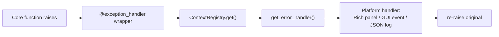

# 🚨 Exception Contract — Structured Error Handling

> `ExceptionHandlerInterface` + the `@exception_handler` decorator — how errors cross the Core/platform boundary without breaking the Layering Invariant.

**Source:** [`exception_interface.py`](exception_interface.py) · **Part of:** `coldwind-core` · **Last Updated:** October 2026

---

## Domain & Dependencies

**Domain:** `core` / `shared`.
Handed out by the master context ([`runtime_interface.md`](runtime_interface.md))
via `get_error_handler()`. Desktop's reference implementation wraps its
`RichTracebackManager` and lives in
[`../../../../../desktop/src/coldwind/desktop/runtime/DesktopContext.py`](../../../../../desktop/src/coldwind/desktop/runtime/DesktopContext.py).

---

## 📌 Executive Summary

Errors in Core follow a strict division of labor:

```text
exception raised inside a Core function
        │
        ▼
  @exception_handler("context")          ← the DECORATOR decides
        │                                  · catch
        │                                  · report (via the handler)
        │                                  · RE-RAISE — always
        ▼
  ExceptionHandlerInterface.handle_exception()   ← the HANDLER decides
        │                                         · how to PRESENT it
        ▼                                         (panel / event / JSON log)
  platform surface
```

> **The one-sentence contract:** the *handler* presents, the *decorator*
> re-raises. Nothing in this package ever swallows an exception silently.

---

## 🧠 The Handler Contract

```python
class ExceptionHandlerInterface(ABC):
    @abstractmethod
    def handle_exception(
        self,
        error: Exception,
        context: str = "",
        extra_context: Optional[dict[str, Any]] = None,
    ) -> None: ...
```

| Argument | Meaning | Example |
|----------|---------|---------|
| `error` | The caught exception instance | `ValueError("bad payload")` |
| `context` | One line: what was happening when it blew up | `"neo4j driver boot"` |
| `extra_context` | Arbitrary structured debugging metadata | `{"wrapped_function": "spawn_agent", "module": "agents.core"}` |

**Implementation rules:**

- `handle_exception()` must **not re-raise**. It is a presenter; the caller
  (usually the decorator) owns the raise/no-raise decision. If your handler
  raises, you turn one error into two.
- It must tolerate `context=""` and `extra_context=None`.
- It must be **cheap and non-blocking on the GUI path** — dispatch an error
  event and return; never run a modal loop inside error handling.

### How each platform presents

| Platform | Presentation | Notes |
|-----------|-------------|-------|
| Desktop CLI | Rich traceback panel via `RichTracebackManager` | Human-styled, colored, full traceback |
| Native GUI | Structured error **event** into the UI queue | UI shows a notification; details go to the debug panel |
| Headless server | JSON log record / error payload to the client | Machine-readable, timestamped, request-scoped |

### GUI structured-capture payload

The audit gap was: "how GUI platforms capture structured exceptions vs Rich
formatting." Answer: serialize the three handler arguments into one flat
dict and sink it, exactly like the message display convention
([`ui_interface.md`](ui_interface.md)):

```python
class GuiExceptionHandler(ExceptionHandlerInterface):
    def __init__(self, event_sink):
        self._sink = event_sink

    def handle_exception(self, error, context="", extra_context=None):
        import traceback
        self._sink({
            "type": "exception",
            "error_class": type(error).__name__,
            "message": str(error),
            "traceback": traceback.format_exception(type(error), error,
                                                    error.__traceback__),
            "context": context,
            "extra_context": extra_context or {},
        })
        # NOTE: no raise here — presentation only
```

A GUI that receives this event can show a toast while filing the full
traceback into its debug panel — the same dual-path the desktop logs use.

---

## 🧵 The `@exception_handler` Decorator

```python
from coldwind.core.interfaces.exception_interface import exception_handler

@exception_handler("neo4j driver boot")
def initialize_neo4j():
    ...
```

**What the wrapper does, step by step:**

1. Calls your function with its original arguments.
2. On `Exception` → resolves the **active** handler dynamically via
   `ContextRegistry.get().get_error_handler()` (late binding — the platform
   can be swapped without re-importing anything).
3. Enriches `extra_context` with `wrapped_function` and `module`, so the
   handler knows *which* function failed even when the traceback is deep.
4. If the handler itself fails, it swallows **that** secondary failure
   (`except Exception: pass`) — error reporting must never become the error.
5. **Re-raises the original exception.** Always. The decorator is a reporter,
   not a suppressor.

```text
func() ──ok──► return result
   │
 exception
   ▼
handler.handle_exception(e, context="name",
                         extra_context={"wrapped_function": f.__name__,
                                        "module": f.__module__})
   ▼
raise e          ◄── the original exception, unchanged
```

### The backward-compatibility alias

```python
rich_exception_handler = exception_handler
```

Old call sites importing `rich_exception_handler` (the desktop-era name) keep
working; both names are the same decorator. Prefer `exception_handler` in new
code.

---

## 🔬 Dynamic Resolution (why this preserves layering)



The decorator imports the registry **inside the wrapper body** (deferred
import). No module-level dependency on any platform, no import cycle, and the
concrete handler is whatever the active context provides at the moment the
error happens.

---

## ✅ Testing Checklist

1. **Re-raise invariant:** a function wrapped with `@exception_handler("t")`
   that raises still propagates the exception to its caller.
2. **Handler receives everything:** the test handler sees the exact
   `error`, `context="t"`, and `extra_context` containing
   `wrapped_function` + `module`.
3. **Handler failure isolation:** a broken handler must not replace the
   original exception.
4. **Alias check:** `rich_exception_handler is exception_handler`.

---

## 📖 Glossary

- **Presenter** — the handler's role: turn an exception into a
  platform-appropriate rendering. Never decides control flow.
- **Late binding** — the concrete handler is looked up through the registry
  at error time, not import time.
- **Secondary-failure guard** — the decorator's inner `except Exception:
  pass` protecting the reporting path.

---

## ❓ Q&A Log

> **Q: Should my handler log the error too?**
> Presenting and logging are different doors. If you want the error in the
> diagnostics stream as well, call your
> [`DebugLoggerInterface`](logging_interface.md) from inside the handler —
> that is a platform choice, not a contract requirement.

> **Q: Why re-raise instead of returning an error value?**
> Core control flow (LangGraph routing, cleanup ordering) depends on
> exceptions. Converting them to return values would force every caller to
  check a sentinel — the classic silent-failure cascade this package exists
> to prevent.

> **Q: Does the decorator catch `BaseException` (e.g. `KeyboardInterrupt`)?**
> No — it catches `Exception`. Interrupts and shutdown signals bypass the
> handler by design; they belong to the platform's lifecycle
> ([`runtime_interface.md`](runtime_interface.md), Pillar 3).

---

**Cold Wind AI · `coldwind-core` · Created in the platform-docs pass (2026-10-10).**
