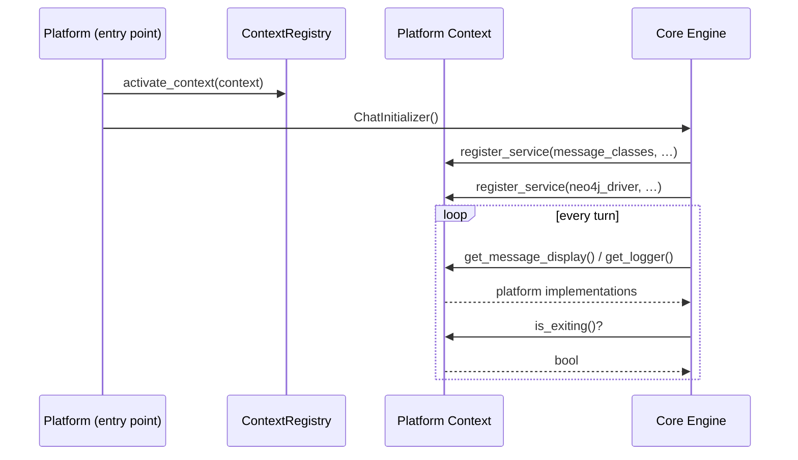

# 🧭 Platform Runtime Context — The Master Contract

> `PlatformRuntimeContextInterface` — the single class every presentation platform must implement to drive Cold Wind AI Core.

**Source:** [`runtime_interface.py`](runtime_interface.py) · **Part of:** `coldwind-core` · **Last Updated:** October 2026

---

## Domain & Dependencies

**Domain:** `core` / `shared`.
This is the master contract of the whole platform-integration story. It depends
on the four satellite contracts ([UI](ui_interface.md),
[exception](exception_interface.md), [logging](logging_interface.md)) plus the
settings base ([`coreSettings.py`](../config/coreSettings.py)). The runtime
packages that consume it are
[`CoreContextRegistry.py`](../runtime/CoreContextRegistry.py) and
[`runtime_obj_enum.py`](../runtime/runtime_obj_enum.py).

---

## 📌 Executive Summary

Core is a **headless agentic engine**. It needs logging, error presentation,
message display, input parsing, and configuration — but it must never know
*how* those are built. `PlatformRuntimeContextInterface` is the deal Core
strikes with every platform:

> **"Build one object that owns all five services, expose them through typed
> getters, let me register and retrieve runtime objects on it, and mirror my
> shutdown flag. I promise to never look behind your getters."**

The contract splits into **four pillars**:

```text
PlatformRuntimeContextInterface
  │
  ├── 1. Typed Service Accessors     (the 5 getters)
  ├── 2. Dynamic Service Store       (register_service / get_service)
  ├── 3. Lifecycle State Machine    (is_exiting / request_exit / reset_exit_request)
  └── 4. Mutable Runtime Slots      (console / debug_console / socket / listeners)
```

---

## 🔑 Pillar 1 — Typed Service Accessors

Five getters hand Core everything it is allowed to touch. Each returns a
contract interface, never a concrete platform class.

| Method | Returns | Backing contract |
|--------|---------|------------------|
| `get_settings()` | `CoreSettinngs` (or a platform subclass) | [`coreSettings.md`](../config/coreSettings.md) |
| `get_logger()` | `DebugLoggerInterface` | [`logging_interface.md`](logging_interface.md) |
| `get_error_handler()` | `ExceptionHandlerInterface` | [`exception_interface.md`](exception_interface.md) |
| `get_message_display()` | `MessageDisplayInterface` | [`ui_interface.md`](ui_interface.md) |
| `get_command_parser()` | `CommandParserInterface` | [`ui_interface.md`](ui_interface.md) |

**Contract rules:**

- Return a **real implementation** from every getter. Returning `None` from a
  typed accessor is a contract violation — Core will call the returned object
  immediately and crash. Build minimal-but-real implementations for headless
  platforms (a stdout logger is 15 lines; see
  [`logging_interface.md`](logging_interface.md)).
- Getters are **hot paths** — Core calls them constantly. Keep them as cheap
  attribute returns, exactly like the desktop pattern
  (`return self._logger`). No construction, no I/O, no locking inside getters.

---

## 🗄️ Pillar 2 — The Dynamic Service Store

Core **injects its own runtime objects into your context at boot** and reads
them back during execution. Two methods make that possible:

```python
def register_service(self, service_type: type, service: Any) -> None: ...
def get_service(self, service_type: type) -> Any: ...
```

**The failure contract (memorize this one):**

> If `get_service()` is queried for an unregistered key it **must raise
> `RuntimeError`** — never silently return `None`.

Why fail fast? A silent `None` surfaces later as an obscure
`TypeError: NoneType is not callable` deep inside an agent node. A
`RuntimeError` at the retrieval site pinpoints the misconfigured boot
immediately. Callers that *expect* a service to be optional (e.g. Neo4j being
down at boot) catch the `RuntimeError` themselves — the store never guesses on
their behalf.

**How Core uses the store at boot:**

```text
ChatInitializer boots
   │
   ▼  context.register_service(CoreRunTimeObjects.message_classes,
                               (HumanMessage, AIMessage, BaseMessage))
   ▼  context.register_service(CoreRunTimeObjects.neo4j_driver, driver)
   │
   ▼  ...later, inside agent nodes:
      HumanMessage, AIMessage, _ = context.get_service(
          CoreRunTimeObjects.message_classes)
```

Your context must own a plain dictionary from construction:

```python
self._services: dict[Any, Any] = {}   # ready BEFORE ChatInitializer runs
```

If Core boots against an immutable or slot-less context, registration raises
and the app dies before the first turn. The enum keys
(`CoreRunTimeObjects`) are documented in
[`../runtime/README.md`](../runtime/README.md).

---

## 🚦 Pillar 3 — The Lifecycle State Machine

One boolean flag, three transitions. This replaces the old pattern of modules
writing `settings.exit_flag` directly.

| Method | Effect | When it fires |
|--------|--------|---------------|
| `is_exiting()` | reads the shutdown flag | Chat loop checks between turns |
| `request_exit()` | sets the flag to `True` | User hits `/exit`, Ctrl+C, or a fatal error |
| `reset_exit_request()` | sets the flag back to `False` | A non-exit message arrives **after** an exit was requested |

```text
        request_exit()                reset_exit_request()
RUNNING ────────────────► EXIT_REQUESTED ────────────────► RUNNING
                            │
                            │  destructor runs, process ends
                            ▼
                          SHUTDOWN
```

**Why `reset_exit_request()` exists:** a queued `/exit` command can be
followed by normal traffic before the loop re-checks the flag; without the
reset the app would die on stale intent. Platforms that never queue input
(CLI) may never see it fire — it exists for event-driven platforms where
messages arrive out of order.

---

## 🧩 Pillar 4 — Mutable Runtime Slots (the non-CLI survival guide)

> ⚠️ This is the part the platform-integration audit flagged as undocumented:
> "No guide exists on how non-CLI platforms satisfy mutable console/socket
> slots." This section is that guide.

Eight abstract methods wrap **four optional value slots**. They exist because
the desktop platform historically kept a rich `Console`, a debug `Console`, a
raw socket, and a listener dict as mutable globals — the contract makes them
explicit, platform-owned state.

| Slot | Getter / Setter | Born as |
|------|-----------------|---------|
| Primary console | `get_console()` / `set_console()` | `None` |
| Debug console | `get_debug_console()` / `set_debug_console()` | `None` |
| Socket connection | `get_socket_connection()` / `set_socket_connection()` | `None` |
| Listeners | `get_listeners()` / `register_listener()` | empty dict |

### The MUTABILITY CONTRACT

- **Slots are born empty and filled late.** Declare them `None` (or `{}`) in
  `__init__`; the orchestrator fills them **post-construction** via the
  `set_*` methods at boot. Building them eagerly in `__init__` and letting the
  orchestrator overwrite them is wasted work.
- **The getters legitimately return `None`** while the slot is unset — callers
  reading before boot **must handle `None` explicitly**. This is *not* a
  contract violation; it is the contract.
- **A platform that does not need a slot may stub it forever.** A headless
  server `get_console()` may `return None` for the whole process lifetime and
  no-op its setter. The contract is satisfied either way.
- **`get_listeners()` always returns the dict** (never `None`); callers add
  entries via `register_listener(key, listener)`, which overwrites on key
  clash.
- **Slots are NOT services.** This is the subtle one: the dynamic service store
  (Pillar 2) *raises* on missing keys; slots *return None* on missing values.
  Services are registry-mandatory; slots are optional values.

### Slot strategy per platform type

| Platform | Consoles | Socket | Listeners |
|----------|----------|--------|-----------|
| **Desktop CLI** | Real rich `Console` objects, filled at boot | Real socket from `SocketManager` | Real dict (seeded with `eval`/`exit`) |
| **Native GUI** (Slint + Rust) | `return None` + no-op setters | GUI's own channel instead | Empty dict or event-bus bridge |
| **Headless server** | `return None` + no-op setters | `return None` (server owns transport) | Empty dict |

### The canonical pattern (from the desktop implementation)

```python
# desktop/src/coldwind/desktop/runtime/DesktopContext.py — excerpt
def __init__(self, settings: DesktopConfig):
    self._settings = settings
    # MUTABLE slots — born None, filled post-construction by the orchestrator
    self._console = None
    self._debug_console = None
    self._socket_con = None
    self._listeners = {"eval": None, "exit": None}
    self._dynamic_services: dict[type, Any] = {}

def get_console(self):
    """Return the primary rich Console, or None if boot has not filled it."""
    return self._console

def set_console(self, console):
    self._console = console
```

Full desktop reference:
[`../../../../../desktop/src/coldwind/desktop/runtime/DesktopContext.py`](../../../../../desktop/src/coldwind/desktop/runtime/DesktopContext.py).

---

## 🧱 A Complete Minimal Headless Context

Every accessor returns a **real** object; every slot stubs honestly. The
satellite implementations can be as small as a stdout logger and a JSON
error printer — see their docs for ready-made skeletons.

```python
from coldwind.core.interfaces.runtime_interface import PlatformRuntimeContextInterface
from coldwind.core.config.coreSettings import CoreSettinngs


class HeadlessContext(PlatformRuntimeContextInterface):
    def __init__(self, settings: CoreSettinngs):
        self._settings = settings
        self._services: dict[Any, Any] = {}
        self._listeners: dict[str, Any] = {}
        self._is_exiting = False
        self._logger = StdoutLogger()          # DebugLoggerInterface impl
        self._error = JsonErrorHandler()       # ExceptionHandlerInterface impl
        self._display = QueueMessageDisplay() # MessageDisplayInterface impl
        self._parser = NullCommandParser()     # CommandParserInterface impl

    # ── Pillar 1 ──
    def get_settings(self): return self._settings
    def get_logger(self): return self._logger
    def get_error_handler(self): return self._error
    def get_message_display(self): return self._display
    def get_command_parser(self): return self._parser

    # ── Pillar 2 ──
    def register_service(self, service_type, service):
        self._services[service_type] = service

    def get_service(self, service_type):
        if service_type not in self._services:
            raise RuntimeError(f"Service {service_type} not registered.")
        return self._services[service_type]

    # ── Pillar 3 ──
    def is_exiting(self): return self._is_exiting
    def request_exit(self): self._is_exiting = True
    def reset_exit_request(self): self._is_exiting = False

    # ── Pillar 4: honest None stubs for a headless process ──
    def get_console(self): return None
    def set_console(self, console): pass
    def get_debug_console(self): return None
    def set_debug_console(self, console): pass
    def get_socket_connection(self): return None
    def set_socket_connection(self, conn): pass
    def get_listeners(self): return self._listeners
    def register_listener(self, key, listener): self._listeners[key] = listener
```

Register it once at the entry point and Core can never tell it isn't a
terminal:

```python
from coldwind.core.runtime.CoreContextRegistry import ContextRegistry
ContextRegistry.activate_context(HeadlessContext(CoreSettinngs()))
```

---

## 🔬 How Core Consumes the Contract



---

## ✅ Testing Checklist

1. **Registration gate:** `ContextRegistry.get()` returns your instance
   right after `activate_context()` — no `RuntimeError`.
2. **Service invariant:** after engine boot,
   `get_service(CoreRunTimeObjects.message_classes)` returns the
   `(HumanMessage, AIMessage, BaseMessage)` bundle; a bogus key raises
   `RuntimeError`.
3. **Slot tolerance:** calling every `get_*` slot getter **before boot**
   returns `None` (or the empty listener dict) without raising.
4. **Lifecycle:** `request_exit()` → `is_exiting() is True` →
   `reset_exit_request()` → `is_exiting() is False`.

---

## 📖 Glossary

- **Platform runtime context** — the platform-owned concrete class implementing
  this interface; the "mother object" bundling all services.
- **Dynamic service store** — the `dict` behind
  `register_service`/`get_service`, keyed by `CoreRunTimeObjects` members.
- **Mutable slot** — an optional value hole (console, socket, listeners)
  filled post-construction; unlike services, missing slots return `None`.

---

## ❓ Q&A Log

> **Q: The module docstring says `RuntimeContextInterface`, the class is
> `PlatformRuntimeContextInterface` — which is real?**
> The class name is authoritative. The module docstring uses the short alias;
> import the full name from `coldwind.core.interfaces.runtime_interface`.

> **Q: Do I have to implement all four console/socket slot pairs on a GUI?**
> No. Declare them, return `None`, no-op the setters — that *is* a valid
> implementation. See the platform table under Pillar 4.

> **Q: Can `get_settings()` return the base `CoreSettinngs` instead of my
> platform subclass?**
> Yes — the return type is the base class. Desktop passes a `DesktopConfig`;
> a headless server can pass plain `CoreSettinngs()`.

> **Q: Where do I read about the engine-side hazards (blocking loop, signal
> trapping)?**
> [Platform Integration Spec](../../../../../reports/urgent_development/platform-integration-spec.md)
> — hazards and decoupled-turn solutions are specified there.

---

**Cold Wind AI · `coldwind-core` · Created in the platform-docs pass (2026-10-10).**
