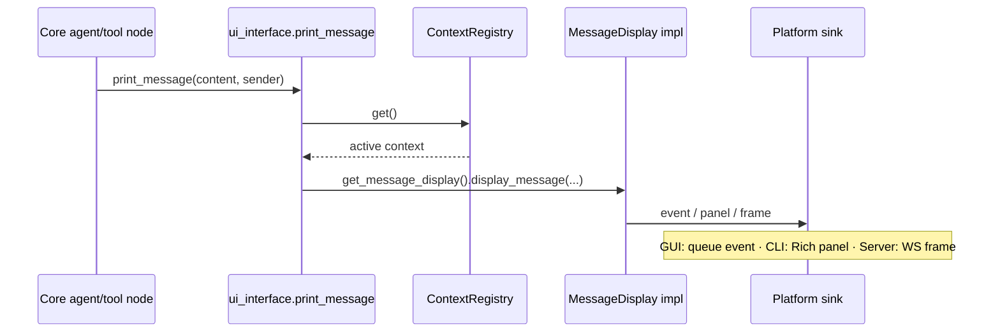

# 🖥️ UI Contracts — Message Display & Command Parsing

> `MessageDisplayInterface` (outbound) + `CommandParserInterface` (inbound) + the `print_message` utility — everything Core knows about "the user".

**Source:** [`ui_interface.py`](ui_interface.py) · **Part of:** `coldwind-core` · **Last Updated:** October 2026

---

## Domain & Dependencies

**Domain:** `core` / `shared`.
These two contracts are handed out by the master context
([`runtime_interface.md`](runtime_interface.md)) via
`get_message_display()` and `get_command_parser()`. Desktop's reference
implementations live in
[`../../../../../desktop/src/coldwind/desktop/runtime/DesktopContext.py`](../../../../../desktop/src/coldwind/desktop/runtime/DesktopContext.py)
(`DesktopMessageDisplay`, `DesktopCommandParser`).

---

## 📌 Executive Summary

Core speaks to "the user" through exactly two doors:

```text
                    ┌───────────────────────────────┐
   OUTBOUND  ──────►  MessageDisplayInterface      │  Core pushes
   (messages,         display_message()            │  chat replies,
    banners)          display_banner()              │  tool outputs
                    └───────────────────────────────┘
                    ┌───────────────────────────────┐
   INBOUND   ◄──────  CommandParserInterface        │  Platform decides
   (user input)       get_user_input()              │  how input arrives
                     parse_and_execute()            │
                    └───────────────────────────────┘
```

- **Outbound is always push.** When Core has something to say, it *calls you*.
  Your implementation decides where the bytes go — Rich panel, GUI event
  queue, WebSocket frame.
- **Inbound is platform-owned.** The *interface* looks like a blocking prompt
  (the CLI heritage), but nothing forces a GUI to use it that way — see the
  [Push vs Pull](#-push-vs-pull--the-input-model-decision) section, which is
  the async event spec the platform-integration audit found missing.

---

## 📤 MessageDisplayInterface (outbound)

| Method | Signature | Purpose |
|--------|-----------|---------|
| `display_message` | `(role: str, content: str, metadata: dict \| None)` | Present one chat message, tool output, or status line |
| `display_banner` | `(title: str, subtitle: str = "")` | Present a section header, welcome banner, or separator |

**The `role` argument** names the *emitter*: `"user"`, `"ai"`, a tool name, an
agent name. It is not decoration — platforms key styling on it (desktop maps
it straight through as the `sender` of its styled printer).

**The `metadata` argument** is an optional structured dict. This is the hook
for platforms that want machine-readable payload alongside the human-readable
text — a GUI can serialize it into its debug panel; a server can attach it to
a WebSocket frame. Core never requires it, so implementations must tolerate
`None`.

**Desktop reference behavior** (honest quirks included):

```python
# DesktopContext.py — DesktopMessageDisplay
def display_message(self, role, content, metadata=None):
    print_message(content, sender=role)   # styled Rich panel, role-keyed

def display_banner(self, title, subtitle=""):
    print_banner()   # NOTE: desktop's banner printer takes no arguments today —
                     # title/subtitle are part of the CONTRACT but unused by the
                     # desktop implementation. New platforms should honor them.
```

> ⚠️ The banner quirk above is a desktop limitation, not license: the
> contract says a banner has a title and optional subtitle. GUI/server
> implementations should render both.

---

## 📥 CommandParserInterface (inbound)

| Method | Signature | Purpose |
|--------|-----------|---------|
| `get_user_input` | `(prompt_text: str = "> ") -> str` | Obtain one raw user turn |
| `parse_and_execute` | `(raw_input: str) -> Any` | Turn raw text into a routed action (slash command or agent turn) |
| `register_default_commands` | `() -> None` | Optional hook: register the platform's built-in commands |

**`register_default_commands()`** is the only concrete (non-abstract) method
in the package's interfaces — the base class provides an empty
implementation, so platforms only override it when they have default commands
to register. Desktop uses it to install its six slash commands
(`clear`, `help`, `exit`, `agent`, `chat_llm`, `use_tool`) at parser
construction time.

**Desktop reference behavior:**

```text
DesktopCommandParser
  ├── InputHandler          (prompt_toolkit session — blocking prompt)
  ├── ParseCommand          (raw text → slash command object)
  ├── ExecutionAr           (slash command → executed action)
  └── register_default_commands()  (installs the 6 desktop slash commands)
```

---

## 🔀 PUSH vs PULL — the input-model decision

> ⚠️ The platform-integration audit flagged exactly this gap:
> "`get_user_input()` implies a pull-based blocking prompt; lacking an
> asynchronous push-event callback spec." This section is that spec.

There are two legitimate input models. Pick one per platform — never mix.

### Model A — PULL (blocking prompt) — the CLI heritage

```text
chat loop:  while not exiting:
              raw = parser.get_user_input()   # BLOCKS the thread until Enter
              parser.parse_and_execute(raw)
```

- Thread waits inside `get_user_input()`.
- Used by: **Desktop CLI** (prompt_toolkit).
- Only valid when a blocking main loop is acceptable.

### Model B — PUSH (event-driven turns) — the GUI/server model

```text
UI event loop (owns the thread):
  submit_event fires ──► turn driver invokes ONE graph turn
  (get_user_input is NEVER called)
```

- The GUI framework owns its event loop; input arrives as **submit events**,
  not method calls that block.
- `get_user_input()` should raise `NotImplementedError` — its existence in the
  interface is CLI heritage, not an obligation.
- The turn driver pattern (invoke the compiled graph directly per submit
  event, on a background worker) is fully specified in the
  [Platform Integration Spec](../../../../../reports/urgent_development/platform-integration-spec.md)
  (§5.2, "Decoupled Single-Turn Execution Engine").
- `parse_and_execute()` **stays useful** under Model B: route the submitted
  text (is it a slash command?) before handing a plain message to a turn.

### Decision table

| Platform | Model | `get_user_input()` | `parse_and_execute()` |
|----------|-------|-------------------|----------------------|
| Desktop CLI | Pull | Block on prompt_toolkit | Parse + execute inline |
| Native GUI (Slint + Rust) | Push | Raise `NotImplementedError` | Validate route per submit event |
| Headless server | Push (request-driven) | Raise `NotImplementedError` | Route per HTTP/WS request |

### GUI event payload convention (for `display_message` implementations)

```python
class GuiMessageDisplay(MessageDisplayInterface):
    def __init__(self, event_sink):
        self._sink = event_sink   # thread-safe callback into the GUI queue

    def display_message(self, role, content, metadata=None):
        self._sink({
            "type": "message",
            "role": role,                    # "user" | "ai" | tool/agent name
            "content": content,              # human-readable text
            "metadata": metadata or {},       # structured addendum
        })

    def display_banner(self, title, subtitle=""):
        self._sink({"type": "banner", "title": title, "subtitle": subtitle})
```

One flat dict per event, always carrying `type`; the GUI switch-cases on
`type` and never parses prose. This is the same convention as the spec's
reference adapter.

---

## 🧰 The `print_message` Utility

A module-level function Core code uses when it has something user-facing to
say but holds no UI reference:

```python
from coldwind.core.interfaces.ui_interface import print_message

print_message(content, sender="user", metadata=None)
```

**What it does:** resolves the active context via
`ContextRegistry.get()` → `get_message_display()` → `display_message()`.
**Why it exists:** it replaced illegal imports of desktop's styled printer
inside core agent and engine modules — preserving the Layering Invariant.
**Pre-boot fallback:** if the registry or display service is not yet
initialized, it degrades to a plain
`print(f"[{sender.upper()}] {content}")` rather than crashing boot.

---

## 🔬 End-to-End Flow



---

## ✅ Testing Checklist

1. **Outbound reaches the sink:** calling `display_message("ai", "hi")` on
   your implementation produces exactly one event/panel/frame with the same
   `role` and `content`.
2. **Banner honors arguments:** `display_banner("Title", "sub")` surfaces both
   strings somewhere visible (don't copy the desktop quirk).
3. **`metadata=None` tolerated:** no `AttributeError` when omitted.
4. **Input model honesty:** under Model B, `get_user_input()` raises
   `NotImplementedError` (a loud refusal beats a silent hang).
5. **Fallback path:** `print_message` before registry activation prints the
   `[SENDER] content` line instead of raising.

---

## 📖 Glossary

- **Pull model** — the platform blocks inside `get_user_input()` waiting for
  a turn; the chat loop owns the thread.
- **Push model** — the platform's event loop stays free; submit events drive
  one graph turn each through a decoupled turn driver.
- **Event sink** — a thread-safe callback a GUI passes into its display
  implementation; the only doorway messages take from Core into UI state.

---

## ❓ Q&A Log

> **Q: My GUI has no prompt — do I still have to implement
> `get_user_input()`?**
> Yes (it's abstract), but you may implement it as
> `raise NotImplementedError(...)`. Under the push model nothing ever calls
> it; the loud refusal documents the decision.

> **Q: Where does the slash-command *registry* itself live?**
> Platform-side. Desktop registers its commands via
> `register_default_commands()` into its own runtime registry; Core only ever
> sees `parse_and_execute()`'s result.

> **Q: Is `metadata` part of any persisted message format?**
> The contract leaves that to the platform. Desktop ignores it today; GUIs
> are encouraged to carry it into debug panels.

---

**Cold Wind AI · `coldwind-core` · Created in the platform-docs pass (2026-10-10).**
