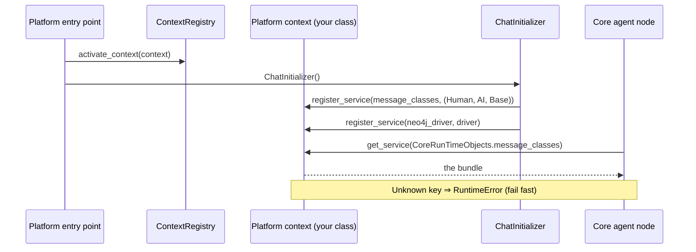

# 🧠 Runtime Package (`coldwind.core.runtime`)

> Two small files that form Core's service-locator spine: the registry that binds your platform context, and the enum that keys Core's injected runtime objects.

**Part of:** `coldwind-core` · **Last Updated:** October 2026

---

## 🗺️ Where This Fits

```text
desktop / GUI / server entry point
        │
        ▼
ContextRegistry.activate_context(platform_context)   ◄── bound ONCE at boot
        │
        ▼
ChatInitializer boots ──► injects runtime objects into the context:
        │                   context.register_service(CoreRunTimeObjects.message_classes, …)
        │                   context.register_service(CoreRunTimeObjects.neo4j_driver, …)
        ▼
Core modules (agent nodes, engine) ──► ContextRegistry.get()
        │                                └──► .get_service(CoreRunTimeObjects.…)
        ▼                                     (RuntimeError if never registered)
   typed access to EVERYTHING the platform provides
```

**Domain & Dependencies:** `core` / `shared`. The registry holds whatever
implements
[`PlatformRuntimeContextInterface`](../interfaces/runtime_interface.md); the
enum keys land inside the context's dynamic service store (Pillar 2 of the
master contract).

---

## 🎯 Why This Exists

- Every Core module needs the platform's services — but importing platform
  concrete classes would shatter the Layering Invariant. One process-wide
  **registry** is the compromise: Core imports only the registry, the
  registry holds only the platform context, the platform context holds the
  services.
- Some Core objects (message classes, the Neo4j driver) are **created by Core
  at boot but consumed everywhere** — they need a typed, collision-proof
  place to live. The **enum-keyed dynamic store** on the context is that
  place, and `CoreRunTimeObjects` is its key set.

---

## 📦 Module Map

| File | What it does (plain English) |
|------|------------------------------|
| [`CoreContextRegistry.py`](CoreContextRegistry.py) | `ContextRegistry` — process-wide holder of the ONE active platform context |
| [`runtime_obj_enum.py`](runtime_obj_enum.py) | `CoreRunTimeObjects` — enum keys for the dynamic service store |

---

## 🔑 ContextRegistry — the single binding point

```python
from coldwind.core.runtime.CoreContextRegistry import ContextRegistry

ContextRegistry.activate_context(my_context)   # once, at boot
context = ContextRegistry.get()                # anywhere, after boot
```

| API | Behavior |
|-----|----------|
| `activate_context(context, force=False)` | Binds the active context. **Second activation is rejected** (`RuntimeError`) unless `force=True` — a double boot is a bug, not a state to silently overwrite. `force=True` exists for tests and intentional hot-reload teardown. |
| `get()` | Returns the active context. Raises `RuntimeError` if nothing was activated yet — deliberately a real exception (not an `assert`) so the invariant survives `python -O` production runs. |

**Design notes:**

- **All state is class-level** (`_instance`, `_active_context` live on the
  class body). You never need to instantiate `ContextRegistry()` — every
  method is a `classmethod`; instantiation is vestigial (the `__new__`
  singleton just returns the same object).
- **Lifecycle invariant:** exactly **one** active context from boot to
  shutdown. Getting the registry before activation is a *boot-order bug* with
  a loud error, not a recoverable condition — callers are not expected to
  guard for it.
- The error message tells you the fix verbatim:
  `"No active context is set. Call ContextRegistry.activate_context(...) at boot."`

> ⚠️ **API drift note:** the
> [Platform Integration Spec](../../../../../reports/urgent_development/platform-integration-spec.md)
> (written earlier) shows `ContextRegistry.set_active_context(...)`. The
> **current** API is `activate_context(context, force=False)` — use that;
> this README documents the live code.

---

## 🧩 CoreRunTimeObjects — the injection key set

```python
class CoreRunTimeObjects(Enum):
    message_classes = "MESSAGE_CLASSES"
    neo4j_driver = "NEO4J_DRIVER"
```

| Member | Holds | Registered when |
|--------|-------|-----------------|
| `message_classes` | The LangChain message bundle `(HumanMessage, AIMessage, BaseMessage)` | `ChatInitializer` boot (`_set_core_classes()`) |
| `neo4j_driver` | The live Neo4j driver instance | Neo4j initialization during boot |

**Conventions baked into the enum (read before extending):**

- **Values mirror member names in SCREAMING_SNAKE_CASE.** Keep the pairing —
  logs and error messages read the value, code reads the member.
- **The member name never leaks tuple cardinality.** It is `message_classes`,
  not `message_class_triple` — the bundle may grow (e.g. adding
  `ToolMessage`) without renaming every call site in the codebase.
- Retrieval is always `context.get_service(CoreRunTimeObjects.<member>)` —
  never a raw string, never a guess. Wrong keys fail loudly via the
  [dynamic store's `RuntimeError` contract](../interfaces/runtime_interface.md).

### The boot-time injection contract (the critical undocumented piece)

> The platform-integration audit flagged exactly this: "Missing explanation
> that Core dynamically injects objects into the context at boot." Here is
> the full lifecycle:



**Obligations on each side:**

- **Platform:** your context's `__init__` must create the services dict
  (`self._services: dict[Any, Any] = {}`) **before** Core boots, so
  `register_service()` has somewhere to land. Immutability or a missing dict
  = crash before the first turn.
- **Core:** registers at boot, retrieves at use, and never assumes a service
  exists when it is genuinely optional — optional consumers catch the
  `RuntimeError` themselves.

### How to add a new runtime object (the 3-step recipe)

1. **Add the enum member** in `runtime_obj_enum.py` — name for code,
   SCREAMING_SNAKE value for logs.
2. **Register at the boot site** that creates the object:
   `context.register_service(CoreRunTimeObjects.<member>, obj)`.
3. **Retrieve at the call site:**
   `obj = ContextRegistry.get().get_service(CoreRunTimeObjects.<member>)`.

No interface changes, no new getters, no platform re-implementation — the
dynamic store absorbs new services by design.

---

## 🚀 Quick Start

```python
# Platform side — the only two lines you ever write against this package
from coldwind.core.runtime.CoreContextRegistry import ContextRegistry
from coldwind.core.runtime.runtime_obj_enum import CoreRunTimeObjects

ContextRegistry.activate_context(my_context)            # boot binding

# Core side — how every module reaches the world
ctx = ContextRegistry.get()
HumanMessage, AIMessage, _ = ctx.get_service(CoreRunTimeObjects.message_classes)
```

---

## ✅ Testing Checklist

1. **Registration gate:** right after `activate_context(ctx)`,
   `ContextRegistry.get() is ctx`.
2. **Pre-boot failure:** `ContextRegistry.get()` before any activation
   raises `RuntimeError` naming `activate_context`.
3. **Double-bind rejection:** a second `activate_context(other)` raises;
   `activate_context(other, force=True)` succeeds (tests only).
4. **Injection invariant:** after engine boot,
   `get_service(CoreRunTimeObjects.message_classes)` returns the 3-bundle;
   `get_service("bogus")` raises `RuntimeError`.

---

## 📖 Glossary

- **Active context** — the one `PlatformRuntimeContextInterface`
  implementation bound to the registry for this process.
- **Dynamic service store** — the dict on the platform context where Core
  injects boot objects; keyed by `CoreRunTimeObjects`.
- **Boot-order bug** — calling `get()` before `activate_context()`; loud by
  design so it never ships silently.

---

## ❓ Q&A Log

> **Q: Why `RuntimeError` instead of returning `None` everywhere?**
> Fail fast beats fail weird. A `None` context would surface as
> `AttributeError` far from the real mistake; the `RuntimeError` lands on the
> exact line that needs fixing. Same philosophy as the dynamic store
> ([`../interfaces/runtime_interface.md`](../interfaces/runtime_interface.md)).

> **Q: Can I hold TWO contexts (e.g. one per window)?**
> No — one process, one active context, by invariant. Multi-window
  platforms multiplex *inside* their single context implementation, not by
> rebinding the registry.

> **Q: Is `ContextRegistry()` ever needed?**
> No. All APIs are classmethods on class-level state; the constructor only
> exists because the singleton `__new__` predates that cleanup.

---

**Cold Wind AI · `coldwind-core` · Created in the platform-docs pass (2026-10-10), closing the platform-integration-spec audit gap "critical undocumented contract: dynamic injection at boot".**
