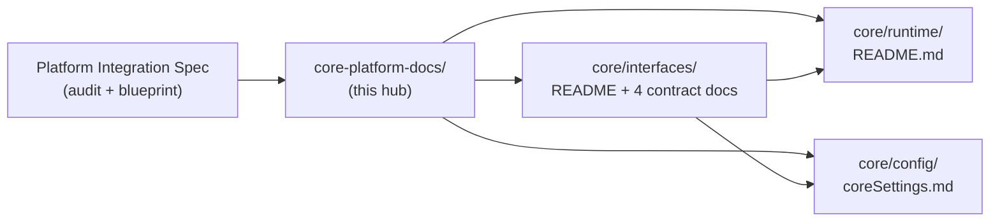

# 📚 Core Platform Docs — Link Hub

> Not a report shelf — the **index** to the in-package integration documentation that closes the platform-integration-spec audit gaps. Click a hyperlink, the doc opens.

---

## Domain

- **core** — the documentation lives inside the core packages it describes (`interfaces/`, `config/`, `runtime/`).
- **shared** — the contracts are the universal Core↔platform boundary; every platform (desktop CLI, Slint+Rust GUI, server) consumes them.

## Overview

The
[Platform Integration Spec](../urgent_development/platform-integration-spec.md)
audited 8 Core source files and found documentation gaps in all of them. This
hub indexes the **6 docs written to close those gaps** — each one filed next
to its source file inside the package, so code and contract never drift
apart.

**Scope note:** the two engine files (`chat_initializer.py`,
`chat_destructor.py`) are deliberately **not** documented — they are slated
for replacement, and their audit rows stay open by design. The remaining six
gaps are closed:

| Audit gap (from the spec) | Closed by |
|---------------------------|-----------|
| No guide for non-CLI platforms satisfying mutable console/socket slots | [`runtime_interface.md`](../../core/src/coldwind/core/interfaces/runtime_interface.md) — Pillar 4 |
| Missing async push-event callback spec for `get_user_input()` | [`ui_interface.md`](../../core/src/coldwind/core/interfaces/ui_interface.md) — Push vs Pull |
| GUI structured-exception capture vs Rich formatting undocumented | [`exception_interface.md`](../../core/src/coldwind/core/interfaces/exception_interface.md) |
| Structured JSON metadata routing to GUI debug panels undocumented | [`logging_interface.md`](../../core/src/coldwind/core/interfaces/logging_interface.md) |
| No document listing required vs optional environment variables | [`coreSettings.md`](../../core/src/coldwind/core/config/coreSettings.md) |
| Dynamic boot injection (`CoreRunTimeObjects`) never explained | [`runtime/README.md`](../../core/src/coldwind/core/runtime/README.md) |

## Interdependence Map

The interfaces contract consumes the settings base and lands its injected
objects in the runtime dynamic store — the three packages are one story,
documented as one.

## Ownership Table

| Domain | Folder | Files documented | Documents |
|--------|--------|------------------|-----------|
| core · shared | `core/src/coldwind/core/interfaces/` | `runtime_interface.py`, `ui_interface.py`, `exception_interface.py`, `logging_interface.py` | [package README](../../core/src/coldwind/core/interfaces/README.md) + 4 deep docs |
| core · shared | `core/src/coldwind/core/config/` | `coreSettings.py` | [coreSettings.md](../../core/src/coldwind/core/config/coreSettings.md) (+ [package README](../../core/src/coldwind/core/config/README.md)) |
| core · shared | `core/src/coldwind/core/runtime/` | `CoreContextRegistry.py`, `runtime_obj_enum.py` | [package README](../../core/src/coldwind/core/runtime/README.md) |

## Index

| # | Document | One-line purpose |
|---|----------|------------------|
| 1 | [**Interfaces Package README**](../../core/src/coldwind/core/interfaces/README.md) | The 5-contract map + the 7-step platform checklist — start here |
| 2 | [**Platform Runtime Context — Master Contract**](../../core/src/coldwind/core/interfaces/runtime_interface.md) | The one class every platform implements: 4 pillars, fail-fast service store, mutable-slot survival guide for non-CLI platforms |
| 3 | [**UI Contracts**](../../core/src/coldwind/core/interfaces/ui_interface.md) | Outbound message display + inbound command parsing; the push-vs-pull input model decision for GUIs |
| 4 | [**Exception Contract**](../../core/src/coldwind/core/interfaces/exception_interface.md) | Handler presents, decorator re-raises; GUI structured-capture payload |
| 5 | [**Logging Contract**](../../core/src/coldwind/core/interfaces/logging_interface.md) | The 5-level `(heading, body, metadata)` stream; JSON metadata routing to debug panels |
| 6 | [**CoreSettinngs — Settings Schema**](../../core/src/coldwind/core/config/coreSettings.md) | All 37 config keys with defaults, env-var mapping rules, placeholder-poison keys, platform subclass contract |
| 7 | [**Runtime Package README**](../../core/src/coldwind/core/runtime/README.md) | ContextRegistry lifecycle invariant + the boot-time dynamic injection contract |

## Related

- Upstream audit and blueprint: [Platform Integration Spec](../urgent_development/platform-integration-spec.md)
- Reports library index: [`../README.md`](../README.md)
- The desktop reference implementation everything cites: [`../../desktop/src/coldwind/desktop/runtime/DesktopContext.py`](../../desktop/src/coldwind/desktop/runtime/DesktopContext.py)

---

**Cold Wind AI · reports/core-platform-docs · Created 2026-10-10 · hub only — no reports live in this folder.**
