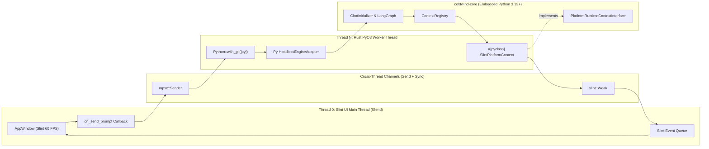

# 🌉 Cross-Platform Architecture — PyO3 Embedding & Slint GUI Integration

| Field | Value |
| :--- | :--- |
| **System** | `cross-platform-docs` (PyO3 + Slint Desktop Integration) |
| **Domain** | `shared`, `core`, `desktop` (`ai-workflow-gui`) |
| **Type** | System Shelf Index & Domain Architecture Overview |
| **Verification Mode** | `Codebase + Research` (PyO3 0.22+ Bound API, CPython 3.13+, Slint 1.8+) |
| **Confidence** | `VERIFIED ✅` |
| **Updated** | `2026-10-22` |

> **TL;DR:** This system shelf documents how Cold Wind AI embeds the Python `coldwind-core` engine inside a native Rust + Slint desktop binary (`ai-workflow-gui`) via PyO3. It enforces a strict two-thread architecture—Thread 0 runs the 60 FPS Slint UI event loop (`!Send`), Thread N hosts the CPython GIL and LangGraph turns—connected by `std::sync::mpsc` channels, `#[pyclass]` platform sinks, and `slint::invoke_from_event_loop`.

## Domain

Cold Wind AI separates headless agent intelligence from presentation layers across three workspace boundaries.

| Platform Package | Role in Cross-Platform Integration | Dependency Direction | Status |
| :--- | :--- | :--- | :--- |
| **`core/` (`coldwind-core`)** | Owns `PlatformRuntimeContextInterface`, `ContextRegistry`, `CoreSettinngs`, `ChatInitializer`, and `CoreRunTimeObjects`. | Imports **nothing** from `desktop/` or Rust GUI. | `VERIFIED ✅` |
| **`desktop/` (`coldwind-desktop`)** | Reference terminal implementation (`DesktopContext.py`, `main_orchestrator.py`) proving the 5 runtime contracts. | Imports `coldwind.core.interfaces.*`. | `VERIFIED ✅` |
| **`shared` / `ai-workflow-gui`** | Native Rust + Slint binary embedding CPython via PyO3 (`Bound<'py, T>`, `Py<T>`, `#[pyclass]` callbacks). | Embeds `coldwind-core` over PyO3 FFI boundary. | `VERIFIED ✅` |

## Overview

The **Cross-Platform Integration System** bridges two fundamentally different runtime models: **CPython 3.13+** (reference-counted `PyObject` heap allocations serialized by a global mutex, the GIL) and **Rust + Slint** (compile-time ownership, thread-affine GPU/window handles, and a 60 FPS reactive event loop).

If a native GUI calls Python synchronously on its main rendering thread, the window freezes during LLM inference (`Not Responding`). Conversely, if a background Python worker attempts to mutate Slint widgets directly, the Rust compiler halts compilation (`error[E0277]: Rc<...> cannot be sent between threads safely`). This shelf breaks the solution into one cross-cutting architecture report, one master war chest, and four progressive subdomains:

| # | Subdomain Folder | Core Architectural Question Answered | `learn_rust` Bridge | Status |
| :--- | :--- | :--- | :--- | :--- |
| **00** | [Root Architecture & War Chest](./00_pyo3_slint_architecture_report.md) | How do all 4 hazards (GIL freeze, `run_chat` blocking, `#[pyclass]` inversion, `!Send` UI handles) fit together? | Topics 01–07 (+ ⏳ 08, 10) | `🟢 Complete` |
| **01** | [`01_pyo3_core_mechanics/`](./01_pyo3_core_mechanics/README.md) | How does Rust initialize CPython, acquire `Python<'py>`, and choose between `Bound<'py, T>` and `Py<T>`? | Topics 01, 04, 06 (`Rc`/`RefCell`) | `🟢 Complete` |
| **02** | [`02_rust_driving_python/`](./02_rust_driving_python/README.md) | How does Rust import `coldwind.core`, instantiate `ChatInitializer`, pass args, and format `PyErr` tracebacks? | Topics 02, 03, 04 (`Result`/`?`) | `🟢 Complete` |
| **03** | [`03_python_driving_rust/`](./03_python_driving_rust/README.md) | How does Rust expose `#[pyclass]` structs so Python `ContextRegistry.get()` can stream tokens back to Rust? | Topics 02, 03, 06 (`RefCell` borrows) | `🟢 Complete` |
| **04** | [`04_slint_concurrency_bridge/`](./04_slint_concurrency_bridge/README.md) | How do `mpsc::channel`, `Weak<AppWindow>`, and `slint::invoke_from_event_loop` keep the UI at 60 FPS? | Topic 06 (`Weak<T>`) + ⏳ Topic 08 | `🟢 Complete` |

## Interdependence Map

**Title:** Dual-Thread Slint + PyO3 + Cold Wind Core Architecture Topology  
*How to read this:* Solid arrows (`-->`) show runtime call/message flow across threads; dashed arrows (`-.->`) show contract implementation across the FFI boundary.



| Boundary Hop | Source Component | Target Component | Transport Mechanism | Thread-Safety Invariant |
| :--- | :--- | :--- | :--- | :--- |
| **1. User Input** | `AppWindow` (Thread 0) | PyO3 Worker (Thread N) | `std::sync::mpsc::Sender<String>` | Non-blocking `<1µs` channel send; UI never touches GIL. |
| **2. Turn Dispatch** | PyO3 Worker (Thread N) | `coldwind.core.engine` | `Bound<'py, PyAny>::call_method1` | Worker acquires `Python<'py>` token; invokes `step_turn`. |
| **3. Callback Sink** | `coldwind.core` nodes | `SlintPlatformContext` | `#[pyclass]` + `#[pymethods]` (`&self`) | Immutable `&self` receiver avoids `PyBorrowError` panics. |
| **4. UI Redraw** | `SlintPlatformContext` | `AppWindow` (Thread 0) | `slint::invoke_from_event_loop` | Captures `slint::Weak<AppWindow>`; upgrades safely on Thread 0. |

## Ownership Table

| Domain | Folder | Files | Documents & Scope |
| :--- | :--- | :--- | :--- |
| **shared / desktop** | [`./`](./README.md) | [`00_pyo3_slint_architecture_report.md`](./00_pyo3_slint_architecture_report.md) | Deep-dive architecture report & Tier 0 Master Guide: 4 hazards, root-cause traces, decoupled adapter blueprint, testing gates, glossary, and Q&A log. |
| **shared / desktop** | [`./`](./README.md) | [`cheat_sheet.md`](./cheat_sheet.md) | Tier 1 Master War Chest (C1–C12): cross-boundary routing tree, GIL lifetime matrix, Python/Rust delta, syntax bank, diagnostics, and trap archive. |
| **shared / core** | [`01_pyo3_core_mechanics/`](./01_pyo3_core_mechanics/README.md) | [`README.md`](./01_pyo3_core_mechanics/README.md), [`cheat_sheet.md`](./01_pyo3_core_mechanics/cheat_sheet.md) | Embedded interpreter boot (`prepare_freethreaded_python`), `Python<'py>` token, `Bound<'py, T>` vs `Py<T>`, `.bind(py)` / `.unbind()`, and type conversions. |
| **shared / core** | [`02_rust_driving_python/`](./02_rust_driving_python/README.md) | [`README.md`](./02_rust_driving_python/README.md), [`cheat_sheet.md`](./02_rust_driving_python/cheat_sheet.md) | `sys.path` workspace injection, `py.import()`, `call0` / `call1` / `call_method1`, 1-tuple syntax trap, `PyDict` state, and `PyErr` traceback formatting. |
| **shared / desktop** | [`03_python_driving_rust/`](./03_python_driving_rust/README.md) | [`README.md`](./03_python_driving_rust/README.md), [`cheat_sheet.md`](./03_python_driving_rust/cheat_sheet.md) | `#[pyclass]`, `#[pymethods]`, `#[new]`, `PyCell` interior mutability borrow flags, `&self` vs `&mut self` re-entrancy hazards, and channel sinks. |
| **desktop (`gui`)** | [`04_slint_concurrency_bridge/`](./04_slint_concurrency_bridge/README.md) | [`README.md`](./04_slint_concurrency_bridge/README.md), [`cheat_sheet.md`](./04_slint_concurrency_bridge/cheat_sheet.md) | Thread 0 `!Send` window handles, `ComponentHandle::as_weak()`, `slint::invoke_from_event_loop`, `py.allow_threads` / `py.detach`, and graceful shutdown. |

## Reading Path & Key Takeaways

**Title:** Progressive Dependency Order Across the 4 Subdomains  
*How to read this:* Read bottom-to-top (`01` → `04`); each subdomain relies strictly on the pointer and ownership vocabulary established in the previous step.

```text
Title: Cross-Platform Study Progression Curve (01 -> 04)

Complexity ▲
           │                                       ┌──────────────────────────────────┐
           │                                       │ 04_slint_concurrency_bridge      │
           │                                       │ Weak<AppWindow>, mpsc channels,  │
           │                                       │ invoke_from_event_loop (60 FPS)  │
           │                                       └────────────────▲─────────────────┘
           │                           ┌────────────────────────────┴─────────────────┐
           │                           │ 03_python_driving_rust                       │
           │                           │ #[pyclass], #[pymethods], &self channel sink │
           │                           └───────────────▲──────────────────────────────┘
           │              ┌────────────────────────────┴──────────────────┐
           │              │ 02_rust_driving_python                        │
           │              │ py.import, call_method1, PyDict, PyErr trace  │
           │              └────────────▲──────────────────────────────────┘
           │ ┌─────────────────────────┴──────────────────────┐
           │ │ 01_pyo3_core_mechanics                         │
           │ │ Python<'py>, Bound<'py, T> vs Py<T>, .unbind() │
           │ └────────────────────────────────────────────────┘
           └──────────────────────────────────────────────────────────────────────────►
             Phase 1 (Memory)        Phase 2 (Calls)         Phase 3 (Sinks)      Phase 4 (GUI)
```

| Takeaway # | Core Invariant | What Breaks If Violated | Owning Document |
| :--- | :--- | :--- | :--- |
| **1. Zero GIL on Thread 0** | Never call `Python::with_gil` inside a Slint UI callback on Thread 0. | Window freezes for 2–30s during LLM/MCP calls; OS flags app unresponsive. | [`00_pyo3_slint_architecture_report.md`](./00_pyo3_slint_architecture_report.md) |
| **2. `Bound<'py, T>` vs `Py<T>`** | Use `Bound<'py, T>` inside `with_gil`; call `.unbind()` to store `Py<T>` in structs. | Rust compiler rejects struct lifetime `'py` (`error[E0597]` / `error[E0106]`). | [`01_pyo3_core_mechanics/README.md`](./01_pyo3_core_mechanics/README.md) |
| **3. Decoupled Turn Driver** | Never call `ChatInitializer.run_chat()` from a GUI; invoke discrete turns on `chat.graph`. | `run_chat()` blocks forever on terminal `get_user_input()`, hanging worker thread. | [`02_rust_driving_python/README.md`](./02_rust_driving_python/README.md) |
| **4. Shared `&self` Sinks** | Declare `#[pymethods]` callback sinks with `&self` + `mpsc::Sender`, never `&mut self`. | Re-entrant Python logging during a turn triggers `PyBorrowMutError` runtime panic. | [`03_python_driving_rust/README.md`](./03_python_driving_rust/README.md) |
| **5. Weak Handle Dispatch** | Send `slint::Weak<AppWindow>` to worker threads and mutate UI via `invoke_from_event_loop`. | Moving `AppWindow` fails with `error[E0277]: !Send`; unguarded upgrade panics on close. | [`04_slint_concurrency_bridge/README.md`](./04_slint_concurrency_bridge/README.md) |

## Index

| Path (Relative) | Document Title | Artifact Type | Verification |
| :--- | :--- | :--- | :--- |
| [`./00_pyo3_slint_architecture_report.md`](./00_pyo3_slint_architecture_report.md) | Architecture Report & Tier 0 Master Guide: Non-Blocking PyO3 & Slint Integration | Design Report + Master Guide (M1–M8) | `VERIFIED ✅` |
| [`./cheat_sheet.md`](./cheat_sheet.md) | Master Cheat Sheet & War Chest — PyO3 + Slint Cross-Platform Integration | Tier 1 War Chest (C1–C12) | `VERIFIED ✅` |
| [`./01_pyo3_core_mechanics/README.md`](./01_pyo3_core_mechanics/README.md) | Subdomain 01 Concept Guide: PyO3 Core Mechanics & GIL Lifetime Model | Subdomain README + Concept Note | `VERIFIED ✅` |
| [`./01_pyo3_core_mechanics/cheat_sheet.md`](./01_pyo3_core_mechanics/cheat_sheet.md) | Subdomain 01 Cheat Sheet: `Python<'py>`, `Bound<'py, T>` & `Py<T>` | Tier 1 Cheat Sheet (C1–C12) | `VERIFIED ✅` |
| [`./02_rust_driving_python/README.md`](./02_rust_driving_python/README.md) | Subdomain 02 Concept Guide: Rust Driving Python Execution Engine | Subdomain README + Concept Note | `VERIFIED ✅` |
| [`./02_rust_driving_python/cheat_sheet.md`](./02_rust_driving_python/cheat_sheet.md) | Subdomain 02 Cheat Sheet: Module Imports, `call_method1` & `PyErr` | Tier 1 Cheat Sheet (C1–C12) | `VERIFIED ✅` |
| [`./03_python_driving_rust/README.md`](./03_python_driving_rust/README.md) | Subdomain 03 Concept Guide: Python Driving Rust Platform Context & Sinks | Subdomain README + Concept Note | `VERIFIED ✅` |
| [`./03_python_driving_rust/cheat_sheet.md`](./03_python_driving_rust/cheat_sheet.md) | Subdomain 03 Cheat Sheet: `#[pyclass]`, `#[pymethods]` & Borrow Safety | Tier 1 Cheat Sheet (C1–C12) | `VERIFIED ✅` |
| [`./04_slint_concurrency_bridge/README.md`](./04_slint_concurrency_bridge/README.md) | Subdomain 04 Concept Guide: Slint Concurrency Bridge & Event Loop Mechanics | Subdomain README + Concept Note | `VERIFIED ✅` |
| [`./04_slint_concurrency_bridge/cheat_sheet.md`](./04_slint_concurrency_bridge/cheat_sheet.md) | Subdomain 04 Cheat Sheet: `Weak<AppWindow>` & `invoke_from_event_loop` | Tier 1 Cheat Sheet (C1–C12) | `VERIFIED ✅` |
| [`../urgent_development/platform-integration-spec.md`](../urgent_development/platform-integration-spec.md) | Upstream Prerequisite: Core Platform Integration & Engine Decoupling Spec | Upstream Contract Spec | `VERIFIED ✅` |
| [`../README.md`](../README.md) | Parent Library Index: Cold Wind AI Reports Library | Root Reports Index | `VERIFIED ✅` |