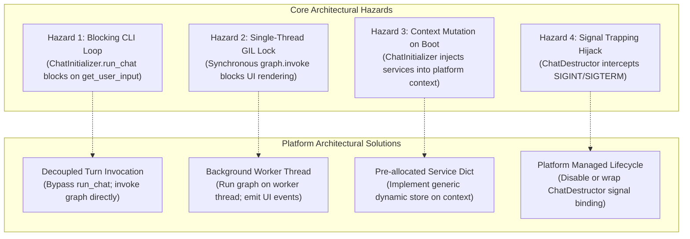

# 🔌 Cold Wind AI — Core Platform Integration & Engine Decoupling Specification

**Cold Wind AI** (`cold-wind-ai`) · **Audit window:** 2026-10-10 · **Status:** ✅ Complete — all 6 in-scope documentation gaps closed; the docs live in the packages and are indexed at [`../core-platform-docs/README.md`](../core-platform-docs/README.md). Shelved as [`core-refactor/01-platform-integration-spec.md`](core-refactor/01-platform-integration-spec.md) alongside the refactoring guide [`core-refactor/02-headless-engine-refactoring-guide.md`](core-refactor/02-headless-engine-refactoring-guide.md). The 2 engine files (`chat_initializer.py`, `chat_destructor.py`) remain undocumented **by design** — slated for replacement.

## Domain & Dependencies

**Domain:** `shared` / `core` / `platform-adapters`  
This specification defines the universal contract between **Cold Wind AI Core** (`coldwind-core`) and external presentation platforms (such as `coldwind-desktop`, the upcoming **Slint + Rust GUI** in `ai-workflow-gui`, or future headless servers).

**Dependencies:**
- **Core Interfaces** ([`../../core/src/coldwind/core/interfaces/`](../../core/src/coldwind/core/interfaces/)): `runtime_interface.py`, `ui_interface.py`, `exception_interface.py`, `logging_interface.py`.
- **Core Engine** ([`../../core/src/coldwind/core/engine/`](../../core/src/coldwind/core/engine/)): `chat_initializer.py`, `chat_destructor.py`, `graphs/node_assign.py`.
- **Core Configuration** ([`../../core/src/coldwind/core/config/`](../../core/src/coldwind/core/config/)): `coreSettings.py`.
- **Core Runtime Store** ([`../../core/src/coldwind/core/runtime/`](../../core/src/coldwind/core/runtime/)): `CoreContextRegistry.py`, `runtime_obj_enum.py`.
- **Desktop Reference Implementation** ([`../../desktop/src/coldwind/desktop/`](../../desktop/src/coldwind/desktop/)): `DesktopContext.py`, `main_orchestrator.py`.

---

## 1. Executive Summary

Cold Wind AI is designed as a **headless agentic engine**. Under the monorepo architectural invariants, Core knows nothing about user interfaces, operating system windows, or terminal emulators. Presentation layers import Core; **Core never imports presentation layers**.

However, because Core was historically coupled to an interactive terminal, the current codebase contains subtle assumptions: blocking user input prompts, synchronous LangGraph execution, and terminal-specific logging. 

This specification acts as an **authoritative audit and implementation blueprint**. It enables an autonomous AI agent or human developer to audit Core's contracts, understand exactly what Core exports and expects, identify critical documentation gaps, and safely bind non-CLI presentation layers (such as event-driven GUIs or background daemons) without freezing threads or violating architectural invariants.

```
┌────────────────────────────────────────────────────────────────────────┐
│                   EXTERNAL PRESENTATION PLATFORM                       │
│        (Desktop CLI  •  Slint+Rust Native GUI  •  FastAPI Server)       │
├────────────────────────────────────────────────────────────────────────┤
│  1. Subclasses CoreSettinngs (Pydantic Settings)                       │
│  2. Implements PlatformRuntimeContextInterface (5 Contracts)           │
│  3. Registers active context via ContextRegistry.set_active_context()  │
└───────────────────────────────────┬────────────────────────────────────┘
                                    │ Binds to & Drives
                                    ▼
┌────────────────────────────────────────────────────────────────────────┐
│                        COLDWIND CORE ENGINE                            │
├────────────────────────────────────────────────────────────────────────┤
│  ContextRegistry.get()  ──► Calls UI / Logger / Error Handlers         │
│  ChatInitializer        ──► Registers tools, compiles LangGraph        │
│  GraphBuilder           ──► Compiles StateGraph (Router, Tools, Agents)│
│  ChatDestructor         ──► Manages graceful resource teardown         │
└────────────────────────────────────────────────────────────────────────┘
```

---

## 2. Core Documentation Audit (Checklist for Autonomous Agents)

Before implementing a platform adapter, an auditing agent must inspect the source files listed below. Currently, **Core exposes zero standalone integration documents or shelf READMEs in `core/interfaces/`**. The table below highlights what exists in source code versus what is missing in written documentation.

| Target Source File | What the File Actually Implements | Documentation Status & Critical Gaps |
|---|---|---|
| [`../../core/src/coldwind/core/interfaces/runtime_interface.py`](../../core/src/coldwind/core/interfaces/runtime_interface.py) | Defines `PlatformRuntimeContextInterface`: master contract for logging, error handling, message display, command parsing, settings, and mutable slots. | ⚠️ **Docstring Only.** No guide exists on how non-CLI platforms satisfy mutable console/socket slots. |
| [`../../core/src/coldwind/core/interfaces/ui_interface.py`](../../core/src/coldwind/core/interfaces/ui_interface.py) | Defines `MessageDisplayInterface` (`display_message`, `display_banner`) and `CommandParserInterface` (`get_user_input`, `parse_and_execute`). | ⚠️ **CLI Bias.** `get_user_input()` implies a pull-based blocking prompt; lacking an asynchronous push-event callback spec. |
| [`../../core/src/coldwind/core/interfaces/exception_interface.py`](../../core/src/coldwind/core/interfaces/exception_interface.py) | Defines `ExceptionHandlerInterface` (`handle_exception`) and decorators (`@exception_handler`, `@rich_exception_handler`). | ⚠️ **Undocumented.** Lacks documentation on how GUI platforms capture structured exceptions vs Rich formatting. |
| [`../../core/src/coldwind/core/interfaces/logging_interface.py`](../../core/src/coldwind/core/interfaces/logging_interface.py) | Defines `DebugLoggerInterface` (`log_debug`, `log_info`, `log_warning`, `log_error`). | ⚠️ **Minimal.** Lacks documentation on structured JSON metadata routing to GUI debug panels. |
| [`../../core/src/coldwind/core/config/coreSettings.py`](../../core/src/coldwind/core/config/coreSettings.py) | Pure Pydantic `BaseSettings` declaring 28 system configuration keys (models, timeouts, Neo4j, MCP). | ⚠️ **Undocumented Schema.** No document lists required vs optional environment variables for new platforms. |
| [`../../core/src/coldwind/core/runtime/runtime_obj_enum.py`](../../core/src/coldwind/core/runtime/runtime_obj_enum.py) | Declares `CoreRunTimeObjects` enum (`message_classes`, `neo4j_driver`). | ⚠️ **Critical Undocumented Contract.** Missing explanation that Core dynamically injects objects into the context at boot. |
| [`../../core/src/coldwind/core/engine/chat_initializer.py`](../../core/src/coldwind/core/engine/chat_initializer.py) | Boots tools, MCP servers, Neo4j, logging handlers, and runs `run_chat()`. | ⚠️ **Major Red Flag.** `run_chat()` blocks on `get_user_input()`. No decoupled `step_turn()` API is documented. |
| [`../../core/src/coldwind/core/engine/chat_destructor.py`](../../core/src/coldwind/core/engine/chat_destructor.py) | Centralized teardown coordinator executing registered destroyer functions. | ⚠️ **Signal Trapping.** Automatically binds POSIX signals; conflicts with host environments managing their own exit loops. |

---

## 3. What Core Exports vs What Core Expects

### 3.1 What Core Exports (Available for Platforms to Consume)

1. **`ContextRegistry`** ([`../../core/src/coldwind/core/runtime/CoreContextRegistry.py`](../../core/src/coldwind/core/runtime/CoreContextRegistry.py)):
   - `ContextRegistry.set_active_context(context)`: Registers the platform's concrete context.
   - `ContextRegistry.get()`: Returns the active `PlatformRuntimeContextInterface`.
2. **`CoreSettinngs`** ([`../../core/src/coldwind/core/config/coreSettings.py`](../../core/src/coldwind/core/config/coreSettings.py)):
   - Base Pydantic class containing all core engine configuration defaults. Platforms subclass this to add custom display modes, GUI themes, or network flags.
3. **`ChatInitializer`** ([`../../core/src/coldwind/core/engine/chat_initializer.py`](../../core/src/coldwind/core/engine/chat_initializer.py)):
   - The primary bootloader. Running `ChatInitializer()` sets up tools, MCP servers, message classes, and compiles the LangGraph graph (`self.graph`).
4. **`ChatDestructor`** ([`../../core/src/coldwind/core/engine/chat_destructor.py`](../../core/src/coldwind/core/engine/chat_destructor.py)):
   - Cleanup coordinator: `ChatDestructor.add_destroyer_function(fn)` registers resource teardown hooks.
5. **`CoreRunTimeObjects`** ([`../../core/src/coldwind/core/runtime/runtime_obj_enum.py`](../../core/src/coldwind/core/runtime/runtime_obj_enum.py)):
   - Enum keys used to retrieve core services from the context (`CoreRunTimeObjects.message_classes`, `CoreRunTimeObjects.neo4j_driver`).
6. **Utility Callables**:
   - `print_message(content, sender, metadata)`: Forwards user-facing messages directly to the active context's display service.
   - `@rich_exception_handler` / `@exception_handler`: Decorators that forward unhandled errors to the platform's error handler.

---

### 3.2 What Core Expects (Mandatory Platform Obligations)

Any platform connecting to Core must implement **`PlatformRuntimeContextInterface`** with the following concrete behaviors:

```
PlatformRuntimeContextInterface
  │
  ├── 1. Typed Service Accessors
  │     ├── get_settings()        ──► Must return CoreSettinngs subclass instance
  │     ├── get_logger()          ──► Must implement DebugLoggerInterface
  │     ├── get_error_handler()   ──► Must implement ExceptionHandlerInterface
  │     ├── get_message_display() ──► Must implement MessageDisplayInterface
  │     └── get_command_parser()  ──► Must implement CommandParserInterface
  │
  ├── 2. Dynamic Service Store (Core-Only Services)
  │     ├── register_service(service_type, service) ──► Stores dynamic objects
  │     └── get_service(service_type)               ──► Retrieves objects (raises RuntimeError if missing)
  │
  ├── 3. Lifecycle State Machine
  │     ├── is_exiting()          ──► bool (checks shutdown flag)
  │     ├── request_exit()        ──► sets shutdown flag to True
  │     └── reset_exit_request()  ──► resets shutdown flag to False
  │
  └── 4. Mutable Runtime Slots (Optional Values)
        ├── get_console() / set_console()
        ├── get_debug_console() / set_debug_console()
        ├── get_socket_connection() / set_socket_connection()
        └── get_listeners() / register_listener()
```

#### The Dynamic Service Store Protocol
Core dynamically injects its own runtime objects into your platform context during `ChatInitializer.__init__()`.
Your context **must** maintain an internal dictionary (e.g. `self._services: dict[Any, Any] = {}`).
- When Core runs `_set_core_classes()`, it calls:
  ```python
  context.register_service(CoreRunTimeObjects.message_classes, (HumanMessage, AIMessage, BaseMessage))
  ```
- When Core agent nodes run, they retrieve classes via:
  ```python
  HumanMessage, AIMessage, BaseMessage = context.get_service(CoreRunTimeObjects.message_classes)
  ```
- **Contract Rule:** If `get_service()` is queried for an unregistered key, it **must raise `RuntimeError`** (never return `None` silently).

---

## 4. Architectural Friction & Hazard Audit

When integrating an event-driven or GUI presentation layer (such as Slint + Rust), four major architectural landmines exist in Core:



### Hazard 1: The Blocking CLI Input Trap (`run_chat`)
- **What Core Does:** `ChatInitializer.run_chat()` calls `context.get_command_parser().get_user_input()`. In desktop, this blocks synchronously on `prompt_toolkit`.
- **The Friction:** An event-driven GUI cannot block on a method call waiting for user input; the GUI framework's event loop (e.g., Slint's event loop) must remain free to process redraws and window events.
- **The Solution:** **Do NOT call `chat.run_chat()`.** Instead, use **Decoupled Turn Invocation**:
  Initialize `chat = ChatInitializer()`, extract the compiled LangGraph instance (`chat.graph`), and invoke single turns asynchronously when the GUI emits a submit event.

### Hazard 2: Single-Thread GIL & UI Animation Freezes
- **What Core Does:** `chat.graph.invoke(state)` executes model inference, tool execution, and RAG searches synchronously on the calling thread.
- **The Friction:** If an embedded GUI thread executes `graph.invoke()`, the Python GIL is held during heavy compute or network waits, causing UI stutters, frozen buttons, and unresponsive windows.
- **The Solution:** Offload turn execution to a dedicated background Python worker thread. The worker thread runs `graph.invoke()` and dispatches tokens and events back to the GUI via thread-safe callbacks or channels.

### Hazard 3: Boot-Time Context Mutation
- **What Core Does:** `ChatInitializer` expects the platform context to exist *before* Core initialization, and actively modifies it during boot (registering message bundles and Neo4j drivers).
- **The Friction:** If a platform developer exposes an immutable context or fails to implement `register_service()`, Core crashes with an unhandled exception before the first turn begins.
- **The Solution:** Ensure the platform context initializes its `_services` dictionary during `__init__`, allowing Core to populate dynamic objects without failure.

### Hazard 4: Signal Handler Interception
- **What Core Does:** `ChatDestructor` installs signal listeners for `signal.SIGINT` and `signal.SIGTERM` using Python's standard `signal` module.
- **The Friction:** In embedded environments (e.g. Rust host binary managing Python via PyO3), Python signal handlers can only be registered on the main thread and may conflict with the host binary's signal handling.
- **The Solution:** Provide a configuration flag or wrapper to bypass `ChatDestructor.register_cleanup_handlers()` when running embedded, delegating exit hooks directly to the host application's teardown lifecycle.

---

## 5. Target Integration Specification (The Decoupled Adapter Model)

To connect an external platform without inheriting legacy CLI baggage, follow this concrete blueprint:

### 5.1 Minimal Platform Runtime Context Implementation

```python
"""
Example non-blocking platform runtime context skeleton.
Location: <platform_package>/runtime/PlatformContext.py
"""
from typing import Any, Optional
from pathlib import Path

from coldwind.core.interfaces.runtime_interface import PlatformRuntimeContextInterface
from coldwind.core.interfaces.ui_interface import MessageDisplayInterface, CommandParserInterface
from coldwind.core.interfaces.exception_interface import ExceptionHandlerInterface
from coldwind.core.interfaces.logging_interface import DebugLoggerInterface
from coldwind.core.config.coreSettings import CoreSettinngs
from coldwind.core.runtime.runtime_obj_enum import CoreRunTimeObjects


class GuiMessageDisplay(MessageDisplayInterface):
    def __init__(self, event_sink_callback):
        self._sink = event_sink_callback

    def display_message(self, role: str, content: str, metadata: Optional[dict[str, Any]] = None) -> None:
        # Pushes message event to GUI event queue instead of printing to terminal
        self._sink({"type": "message", "role": role, "content": content, "metadata": metadata or {}})

    def display_banner(self, title: str, subtitle: str = "") -> None:
        self._sink({"type": "banner", "title": title, "subtitle": subtitle})


class GuiCommandParser(CommandParserInterface):
    def get_user_input(self, prompt_text: str = "> ") -> str:
        # Should not be called under Decoupled Turn Invocation model
        raise NotImplementedError("GUI platforms drive turns push-style; get_user_input() is deprecated.")

    def parse_and_execute(self, raw_input: str) -> Any:
        # Dispatches slash commands or validates input
        return None


class UniversalPlatformContext(PlatformRuntimeContextInterface):
    """Universal platform context satisfying Core invariants without terminal assumptions."""

    def __init__(self, settings: CoreSettinngs, event_sink: Any):
        self._settings = settings
        self._services: dict[Any, Any] = {}
        self._listeners: dict[str, Any] = {}
        self._is_exiting = False
        
        # Instantiate satellite services
        self._display = GuiMessageDisplay(event_sink)
        self._parser = GuiCommandParser()
        # Fallbacks for logger and error handlers
        self._logger = None        # Provide concrete DebugLoggerInterface
        self._error_handler = None # Provide concrete ExceptionHandlerInterface

    def get_settings(self) -> CoreSettinngs:
        return self._settings

    def get_logger(self) -> DebugLoggerInterface:
        return self._logger

    def get_error_handler(self) -> ExceptionHandlerInterface:
        return self._error_handler

    def get_message_display(self) -> MessageDisplayInterface:
        return self._display

    def get_command_parser(self) -> CommandParserInterface:
        return self._parser

    def get_service(self, service_type: type) -> Any:
        if service_type not in self._services:
            raise RuntimeError(f"Service {service_type} has not been registered in context.")
        return self._services[service_type]

    def register_service(self, service_type: type, service: Any) -> None:
        self._services[service_type] = service

    def is_exiting(self) -> bool:
        return self._is_exiting

    def request_exit(self) -> None:
        self._is_exiting = True

    def reset_exit_request(self) -> None:
        self._is_exiting = False

    # Mutable slots (Headless / GUI platforms return None or stub instances)
    def get_console(self) -> Any: return None
    def set_console(self, console: Any) -> None: pass
    def get_debug_console(self) -> Any: return None
    def set_debug_console(self, console: Any) -> None: pass
    def get_socket_connection(self) -> Any: return None
    def set_socket_connection(self, conn: Any) -> None: pass
    def get_listeners(self) -> Any: return self._listeners
    def register_listener(self, key: str, listener: Any) -> None: self._listeners[key] = listener
```

---

### 5.2 Decoupled Single-Turn Execution Engine

This pattern allows any external application to run turns without entering the blocking `run_chat()` loop:

```python
"""
Decoupled Turn Driver
Bypasses ChatInitializer.run_chat() to provide clean, event-driven turn execution.
"""
from coldwind.core.runtime.CoreContextRegistry import ContextRegistry
from coldwind.core.runtime.runtime_obj_enum import CoreRunTimeObjects
from coldwind.core.engine.chat_initializer import ChatInitializer


class HeadlessEngineAdapter:
    """Manages Core initialization and exposes non-blocking single-turn execution."""

    def __init__(self, platform_context):
        # 1. Register context
        ContextRegistry.set_active_context(platform_context)
        
        # 2. Boot Core engine (populates services, registers tools, compiles graph)
        self.chat_init = ChatInitializer()
        self.graph = self.chat_init.graph
        self.state = self.chat_init._state

    def execute_turn(self, user_message: str) -> dict[str, Any]:
        """
        Execute a single conversation turn synchronously or in a background worker thread.
        Emits events to platform context display services in real-time.
        """
        HumanMessage, _, _ = ContextRegistry.get().get_service(CoreRunTimeObjects.message_classes)
        
        # Append message and invoke graph
        self.state["messages"].append(HumanMessage(content=user_message))
        self.state = self.graph.invoke(self.state)
        
        # Sync state accessor for memory persistence
        self.chat_init.state_accessor.sync_with_langgraph(self.state)
        
        return self.state
```

---

## 6. Testing & Validation Checklist

When developing or auditing a platform adapter, verify these four criteria before connecting to agent models:

1. **Context Registration Gate:**
   - Execute `ContextRegistry.get()` immediately after platform boot. Confirm it returns your concrete platform instance without raising `RuntimeError`.
2. **Service Store Invariant:**
   - Confirm `get_service(CoreRunTimeObjects.message_classes)` succeeds after `ChatInitializer()` runs and returns the `(HumanMessage, AIMessage, BaseMessage)` tuple.
   - Confirm `get_service("NON_EXISTENT_KEY")` explicitly raises `RuntimeError`.
3. **Non-Blocking GUI Verification:**
   - Verify that triggering a turn (`execute_turn()`) from a background thread does not block UI refresh cycles or cause window stutter.
4. **Clean Destructor Teardown:**
   - Confirm that calling registered destroyer functions on exit releases models, closes MCP server subprocesses, and leaves zero orphaned background tasks.

---

## 7. Quick Reference & Contract Summary

| Contract / Feature | Core Interface | Required Platform Action |
|---|---|---|
| **Context Registration** | `CoreContextRegistry` | Call `ContextRegistry.set_active_context(instance)` at entry point |
| **Settings Schema** | `CoreSettinngs` | Subclass `CoreSettinngs` using `pydantic-settings` (add platform paths) |
| **User Message Output** | `MessageDisplayInterface` | Route `display_message()` to UI state or GUI channels |
| **Core Message Types** | `CoreRunTimeObjects.message_classes` | Stored in dynamic dictionary; Core injects at boot |
| **Turn Invocation** | `CompiledStateGraph` | Invoke `chat_init.graph.invoke(state)` on background thread |
| **Graceful Shutdown** | `ChatDestructor` | Register platform cleanup via `add_destroyer_function()` |

---

## 8. Glossary

- **Platform Runtime Context:** The concrete platform-owned object implementing `PlatformRuntimeContextInterface` that provides OS, display, and logging capabilities to Core.
- **ContextRegistry:** The Core-owned singleton locator used by all Core modules to discover the active platform context.
- **Decoupled Turn Invocation:** The execution pattern where an external UI invokes LangGraph turn-by-turn on a background thread instead of relinquishing control to `run_chat()`.
- **Dynamic Service Store:** The dictionary mechanism on the platform context allowing Core to register and retrieve runtime objects keyed by `CoreRunTimeObjects`.

---

## 9. Q&A Log

> **Q: Why does Core require `get_service()` to raise `RuntimeError` instead of returning `None`?**  
> To prevent silent failure cascades. If a required runtime object (like `message_classes`) is missing, failing fast with a clear error pinpoints misconfigured initialization immediately, rather than causing an obscure `TypeError: NoneType is not callable` deep inside an agent node.

> **Q: Can a platform completely ignore `get_console()` and `get_socket_connection()`?**  
> Yes. The contract specifies that mutable slots are optional for non-desktop platforms. Headless servers and native GUIs can safely return `None` from `get_console()` and `get_socket_connection()`.

> **Q: Where does state live between turns in the Decoupled Adapter Model?**  
> Inside `chat_init._state` (typed as `State: {"messages": [...], "message_type": ...}`) and synchronized with `chat_init.state_accessor`. Each turn appends the new message and passes the dictionary to `graph.invoke()`.
